# Design System Presets

[简体中文](theme.md) | [English](theme_EN.md)

The skill ships multiple design systems. Use them **only when the user names one** (self-directed design does not auto-pick a preset).

## How to use

Name a theme ID in the prompt, for example:

```text
Use open-pptd with theme pine-green-strategy to make an AI strategy consulting deck, about 12 pages
```

The agent loads the matching `design.md` (or the numbered catalog `.md`) as the sole style source.

---

## Primary catalog (recommended)

### Consulting / Strategy

*Strategy consulting, due diligence, transformation, executive briefings*

#### `apricot-white-brief` — Apricot White Brief

- **Look**: Apricot-white consulting brief; dense argumentation, fine-line charts
- **File**: [`consulting/apricot-white-brief/design.md`](skills/open-pptd/reference/design_system/consulting/apricot-white-brief/design.md)
- **Invoke**: `use apricot-white-brief`

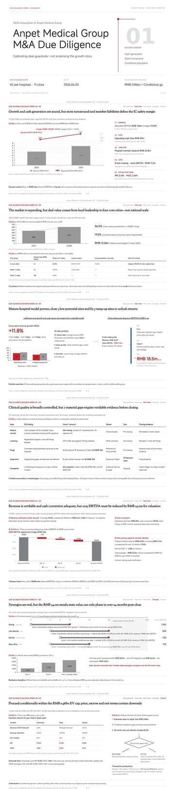

#### `indigo-due-diligence` — Indigo Due Diligence

- **Look**: Indigo due-diligence look; McKinsey-like density and frameworks
- **File**: [`consulting/indigo-due-diligence/design.md`](skills/open-pptd/reference/design_system/consulting/indigo-due-diligence/design.md)
- **Invoke**: `use indigo-due-diligence`

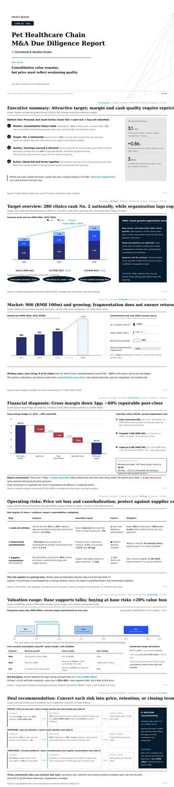

#### `marine-blue-research` — Marine Blue Research

- **Look**: Marine-blue research report layout for professional consulting
- **File**: [`consulting/marine-blue-research/design.md`](skills/open-pptd/reference/design_system/consulting/marine-blue-research/design.md)
- **Invoke**: `use marine-blue-research`

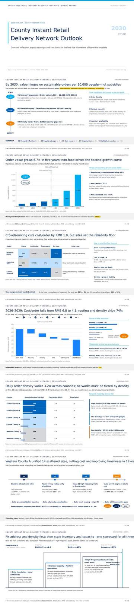

#### `moss-green-transformation` — Moss Green Transformation

- **Look**: Moss-green transformation narrative for strategic change
- **File**: [`consulting/moss-green-transformation/design.md`](skills/open-pptd/reference/design_system/consulting/moss-green-transformation/design.md)
- **Invoke**: `use moss-green-transformation`

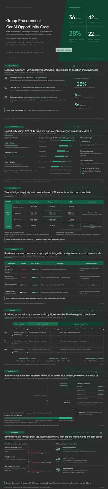

#### `pine-green-strategy` — Pine Green Strategy

- **Look**: Pine-green strategy; dark title banner + mint accents
- **File**: [`consulting/pine-green-strategy/design.md`](skills/open-pptd/reference/design_system/consulting/pine-green-strategy/design.md)
- **Invoke**: `use pine-green-strategy`

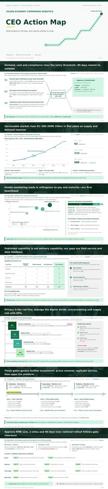

#### `red-black-growth` — Red-Black Growth

- **Look**: Red-black growth story; high-contrast, conclusion-led
- **File**: [`consulting/red-black-growth/design.md`](skills/open-pptd/reference/design_system/consulting/red-black-growth/design.md)
- **Invoke**: `use red-black-growth`

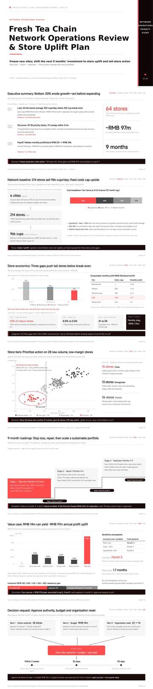

---

### Finance / Business

*Investment research, annual reports, memos, financial analysis*

#### `black-gold-ledger` — Black Gold Ledger

- **Look**: Black-gold ledger; institutional investment research
- **File**: [`finance/black-gold-ledger/design.md`](skills/open-pptd/reference/design_system/finance/black-gold-ledger/design.md)
- **Invoke**: `use black-gold-ledger`

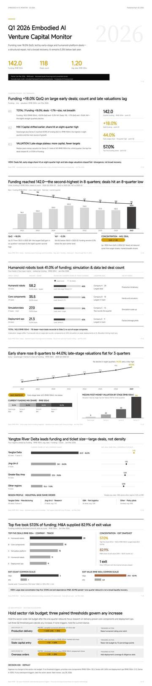

#### `ebony-ledger` — Ebony Ledger

- **Look**: Ebony ledger; calm institutional-annual tone on pure white ground with black structure (pure white ground; dark full-bleed pages prohibited)
- **File**: [`finance/ebony-ledger/design.md`](skills/open-pptd/reference/design_system/finance/ebony-ledger/design.md)
- **Invoke**: `use ebony-ledger`

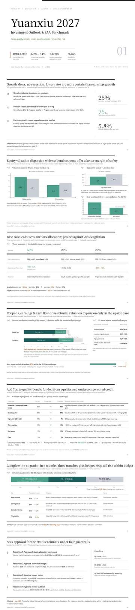

#### `honey-orange-memo` — Honey Orange Memo

- **Look**: Honey-orange memo; warm business research notes
- **File**: [`finance/honey-orange-memo/design.md`](skills/open-pptd/reference/design_system/finance/honey-orange-memo/design.md)
- **Invoke**: `use honey-orange-memo`

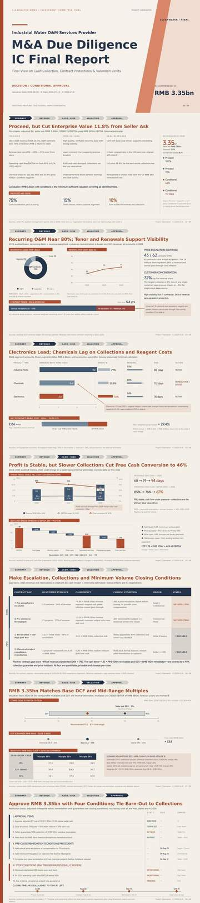

#### `lake-blue-memo` — Lake Blue Memo

- **Look**: Lake-blue memo; clean financial research notes
- **File**: [`finance/lake-blue-memo/design.md`](skills/open-pptd/reference/design_system/finance/lake-blue-memo/design.md)
- **Invoke**: `use lake-blue-memo`

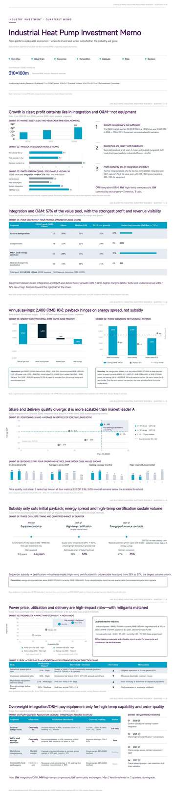

#### `prospect-annual` — Prospect Annual

- **Look**: Prospect annual; institutional yearbook / research publishing feel
- **File**: [`finance/prospect-annual/design.md`](skills/open-pptd/reference/design_system/finance/prospect-annual/design.md)
- **Invoke**: `use prospect-annual`

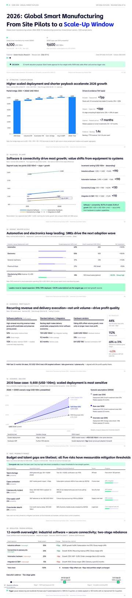

#### `rice-paper-annual` — Rice Paper Annual

- **Look**: Rice-paper annual; warm off-white paper, bold editorial headlines
- **File**: [`finance/rice-paper-annual/design.md`](skills/open-pptd/reference/design_system/finance/rice-paper-annual/design.md)
- **Invoke**: `use rice-paper-annual`

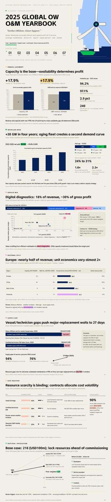

---

### Work Report

*Operating reviews, project progress, brand and business summaries*

#### `blue-flame-brand` — Blue Flame Brand

- **Look**: Blue-flame brand; conclusion-first business review
- **File**: [`work/blue-flame-brand/design.md`](skills/open-pptd/reference/design_system/work/blue-flame-brand/design.md)
- **Invoke**: `use blue-flame-brand`

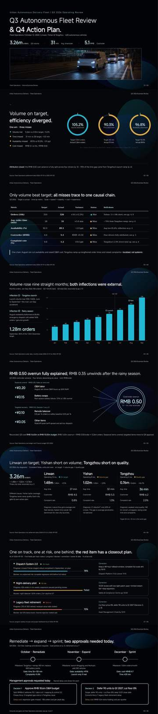

#### `electric-violet-business` — Electric Violet Business

- **Look**: Electric-violet business; operating review and progress updates
- **File**: [`work/electric-violet-business/design.md`](skills/open-pptd/reference/design_system/work/electric-violet-business/design.md)
- **Invoke**: `use electric-violet-business`

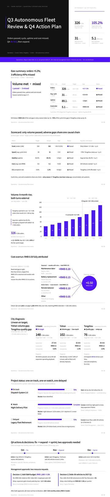

#### `moon-white-imagery` — Moon-White Imagery

- **Look**: Moon-white imagery; photo-led narrative + business conclusions
- **File**: [`work/moon-white-imagery/design.md`](skills/open-pptd/reference/design_system/work/moon-white-imagery/design.md)
- **Invoke**: `use moon-white-imagery`

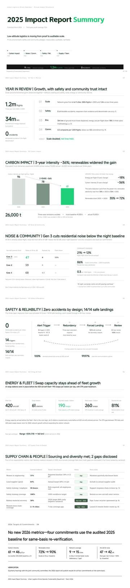

#### `sky-blue-wayfinding` — Sky Blue Wayfinding

- **Look**: Sky-blue wayfinding; clear navigational work reports
- **File**: [`work/sky-blue-wayfinding/design.md`](skills/open-pptd/reference/design_system/work/sky-blue-wayfinding/design.md)
- **Invoke**: `use sky-blue-wayfinding`

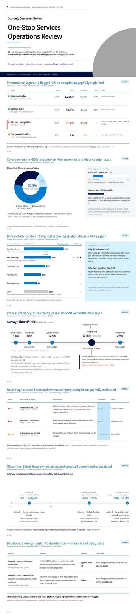

#### `warm-clay-works` — Warm Clay Works

- **Look**: Warm-clay works; portfolio-grade polished reviews
- **File**: [`work/warm-clay-works/design.md`](skills/open-pptd/reference/design_system/work/warm-clay-works/design.md)
- **Invoke**: `use warm-clay-works`

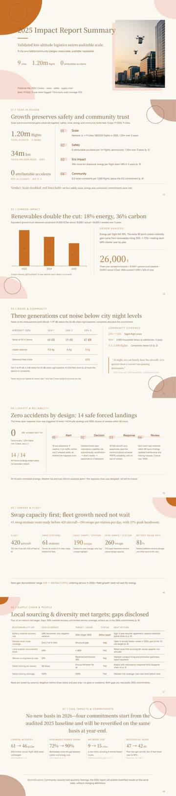

#### `warm-jade-annual-report` — Warm Jade Annual Report

- **Look**: Warm-jade annual report; operating yearbook and retros
- **File**: [`work/warm-jade-annual-report/design.md`](skills/open-pptd/reference/design_system/work/warm-jade-annual-report/design.md)
- **Invoke**: `use warm-jade-annual-report`

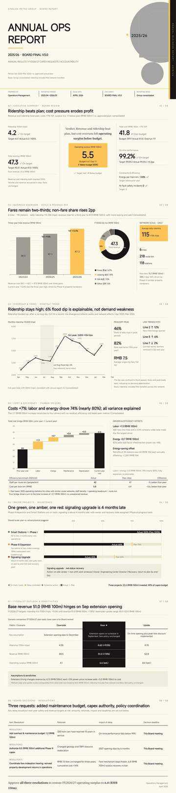

---

### Promotion / Brand

*Brand storytelling, magazine layouts, campaigns and nonprofit comms*

#### `aqua-charity-report` — Aqua Charity Report

- **Look**: Aqua charity report; brand nonprofit storytelling
- **File**: [`promotion/aqua-charity-report/design.md`](skills/open-pptd/reference/design_system/promotion/aqua-charity-report/design.md)
- **Invoke**: `use aqua-charity-report`

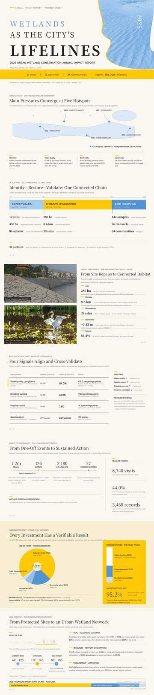

#### `cream-collage` — Cream Collage

- **Look**: Cream collage; emotional brand collage narrative
- **File**: [`promotion/cream-collage/design.md`](skills/open-pptd/reference/design_system/promotion/cream-collage/design.md)
- **Invoke**: `use cream-collage`

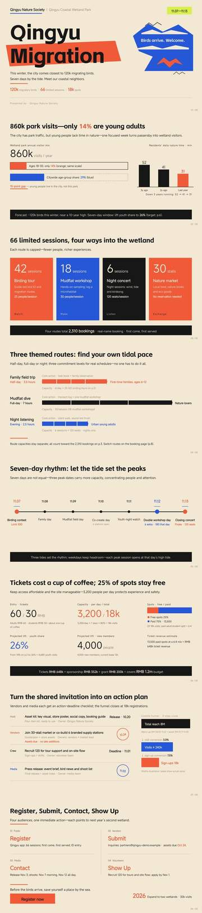

#### `pine-soot-pictorial` — Pine Soot Pictorial

- **Look**: Pine-soot pictorial; pictorial brand annual
- **File**: [`promotion/pine-soot-pictorial/design.md`](skills/open-pptd/reference/design_system/promotion/pine-soot-pictorial/design.md)
- **Invoke**: `use pine-soot-pictorial`

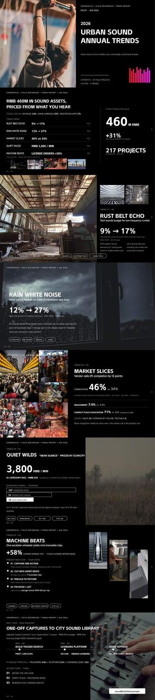

#### `silk-yellow-magazine` — Silk Yellow Magazine

- **Look**: Silk-yellow magazine; dense editorial magazine layout
- **File**: [`promotion/silk-yellow-magazine/design.md`](skills/open-pptd/reference/design_system/promotion/silk-yellow-magazine/design.md)
- **Invoke**: `use silk-yellow-magazine`

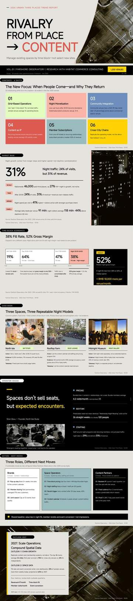

#### `silver-gray-luxury-magazine` — Silver-Gray Luxury Magazine

- **Look**: Silver-gray luxury magazine; premium brand periodical feel
- **File**: [`promotion/silver-gray-luxury-magazine/design.md`](skills/open-pptd/reference/design_system/promotion/silver-gray-luxury-magazine/design.md)
- **Invoke**: `use silver-gray-luxury-magazine`

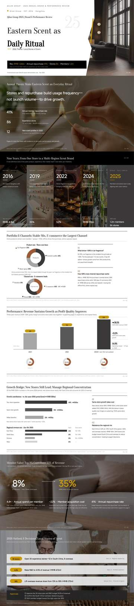

#### `travel-green-handbook` — Travel Green Handbook

- **Look**: Travel-green handbook; travel / destination guidebook tone
- **File**: [`promotion/travel-green-handbook/design.md`](skills/open-pptd/reference/design_system/promotion/travel-green-handbook/design.md)
- **Invoke**: `use travel-green-handbook`

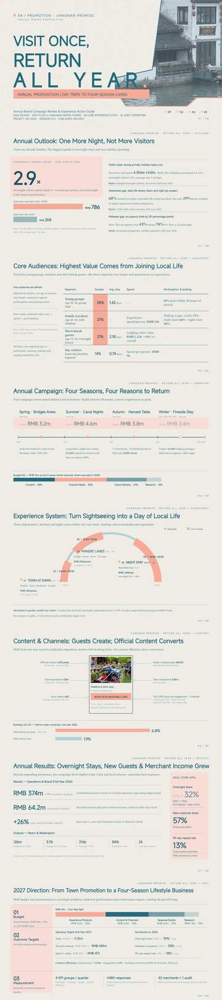

---

### Academic

*Defenses, courseware, research talks, data-driven derivations*

#### `blue-line-courseware` — Blue-Line Courseware

- **Look**: Blue-line courseware; rigorous academic lecture layout
- **File**: [`academic/blue-line-courseware/design.md`](skills/open-pptd/reference/design_system/academic/blue-line-courseware/design.md)
- **Invoke**: `use blue-line-courseware`

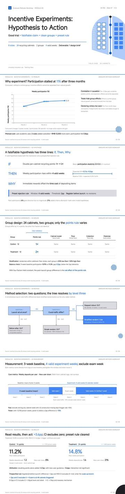

#### `deep-blue-atlas` — Deep Blue Atlas

- **Look**: Deep-blue atlas; research talk and atlas narrative
- **File**: [`academic/deep-blue-atlas/design.md`](skills/open-pptd/reference/design_system/academic/deep-blue-atlas/design.md)
- **Invoke**: `use deep-blue-atlas`

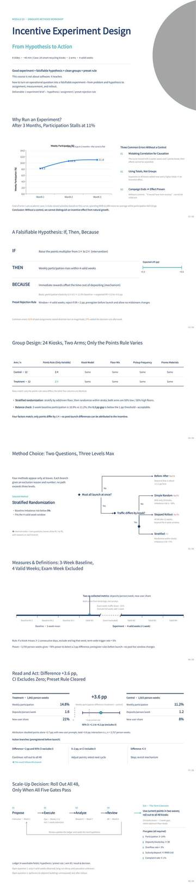

#### `paper-white-courseware` — Paper White Courseware

- **Look**: Paper-white courseware; thesis-defense-level typesetting
- **File**: [`academic/paper-white-courseware/design.md`](skills/open-pptd/reference/design_system/academic/paper-white-courseware/design.md)
- **Invoke**: `use paper-white-courseware`

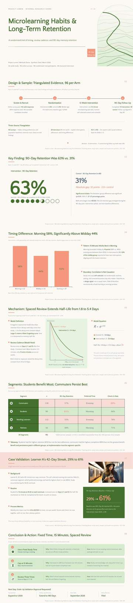

#### `pastel-derivation` — Pastel Derivation

- **Look**: Pastel derivation; formula / step-by-step reveal
- **File**: [`academic/pastel-derivation/design.md`](skills/open-pptd/reference/design_system/academic/pastel-derivation/design.md)
- **Invoke**: `use pastel-derivation`

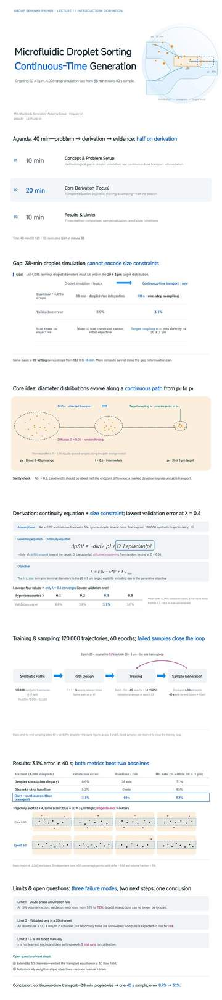

#### `teal-green-academic-defense` — Teal-Green Academic Defense

- **Look**: Teal-green academic defense; formal thesis defense look
- **File**: [`academic/teal-green-academic-defense/design.md`](skills/open-pptd/reference/design_system/academic/teal-green-academic-defense/design.md)
- **Invoke**: `use teal-green-academic-defense`

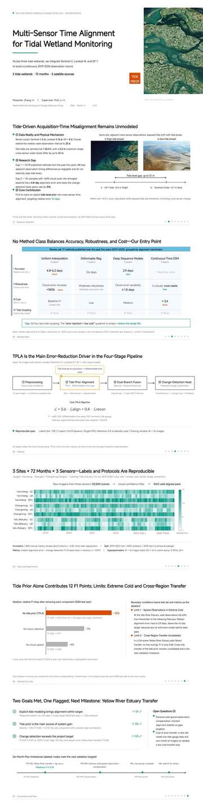

#### `wine-red-data` — Wine Red Data

- **Look**: Wine-red data; academic data visualization
- **File**: [`academic/wine-red-data/design.md`](skills/open-pptd/reference/design_system/academic/wine-red-data/design.md)
- **Invoke**: `use wine-red-data`

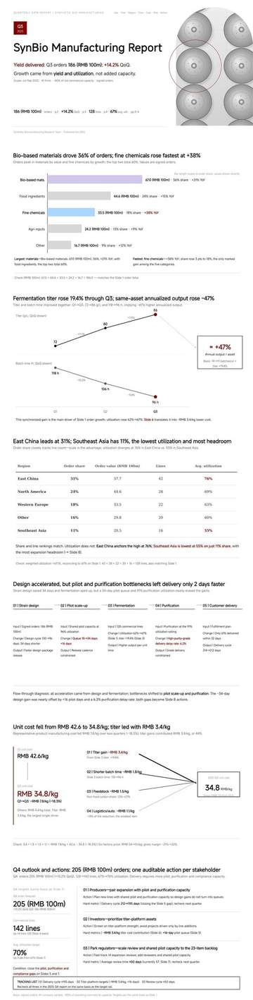

---

## Extra catalog (Palette-Only)

> **Note**: The following 14 extra themes provide palette and visual sample references only; they **do not have dedicated `design.md` specification files**. Agents must not treat them as fully specified design systems; adhere to general layout rules and apply the sample palette and tone.

Visual style references that complement the primary catalog, offering emotional and differentiated expressions across various industries; can also be invoked by theme ID or style description.

### Strategy

#### `dusk-violet-consulting` — Dusk Violet Consulting
- **Spec**: Palette-only (no design.md spec)
- **Look**: Dusk-violet consulting thought-leadership report
- **Invoke**: `use dusk-violet-consulting`

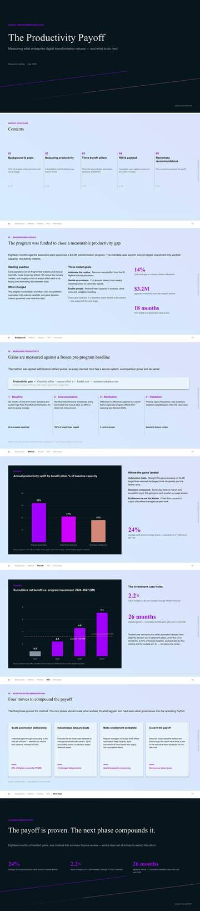

#### `red-black-business` — Red Black Business
- **Spec**: Palette-only (no design.md spec)
- **Look**: Red-black management-consulting full-package template
- **Invoke**: `use red-black-business`

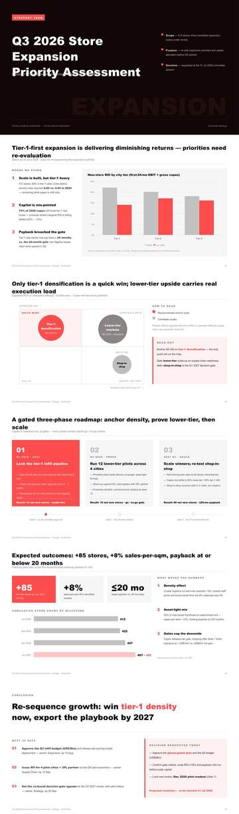

#### `map-strategy` — Cartographic Strategy
- **Spec**: Palette-only (no design.md spec)
- **Look**: Map strategy; internationalization / regional footprint
- **Invoke**: `use map-strategy`

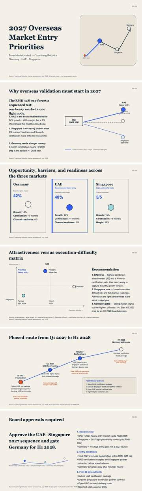

### Business

#### `xuan-paper-annual` — Xuan Paper Annual
- **Spec**: Palette-only (no design.md spec)
- **Look**: Xuan-paper annual; ultra-heavy headlines, editorial research journal
- **Invoke**: `use xuan-paper-annual`

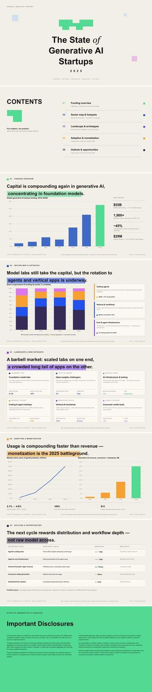

#### `lead-gray-quarterly` — Lead Gray Quarterly
- **Spec**: Palette-only (no design.md spec)
- **Look**: Lead-gray quarterly; financial-newspaper data monitor
- **Invoke**: `use lead-gray-quarterly`

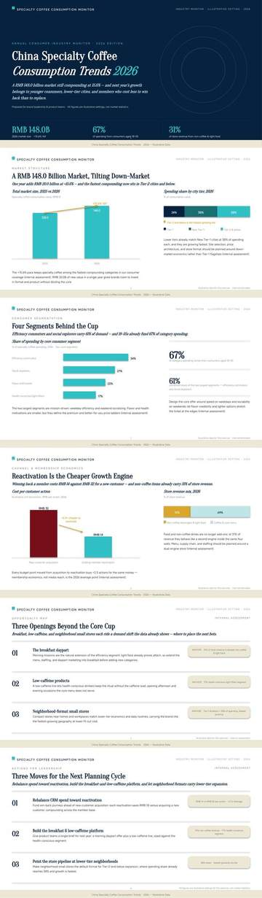

#### `ink-green-market-trends` — Ink Green Market Trends
- **Spec**: Palette-only (no design.md spec)
- **Look**: Ink-green market trends; dark crypto / market quarterly
- **Invoke**: `use ink-green-market-trends`

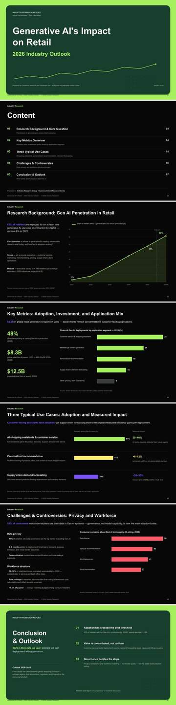

#### `orange-tech` — Orange Tech
- **Spec**: Palette-only (no design.md spec)
- **Look**: Orange tech annual report and business-insight deck
- **Invoke**: `use orange-tech`

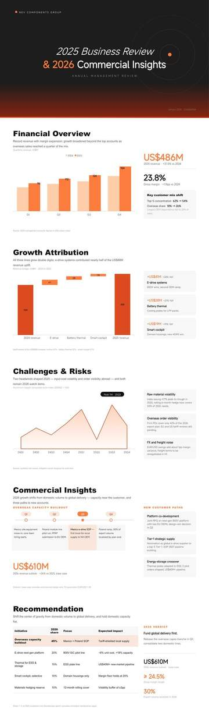

### Work

#### `mist-blue-travelogue` — Mist Blue Travelogue
- **Spec**: Palette-only (no design.md spec)
- **Look**: Mist-blue travelogue; travel / hospitality industry research
- **Invoke**: `use mist-blue-travelogue`

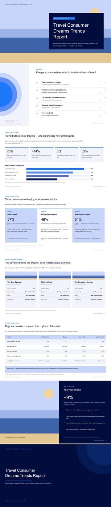

#### `color-stripes-documentary` — Color Stripes Documentary
- **Spec**: Palette-only (no design.md spec)
- **Look**: Color-stripes documentary; impact / ESG long-form narrative
- **Invoke**: `use color-stripes-documentary`

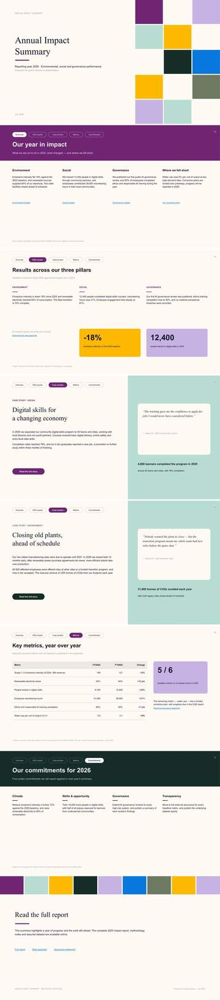

#### `red-white-business` — Red White Business
- **Spec**: Palette-only (no design.md spec)
- **Look**: Red-white business; employer brand and org capability
- **Invoke**: `use red-white-business`

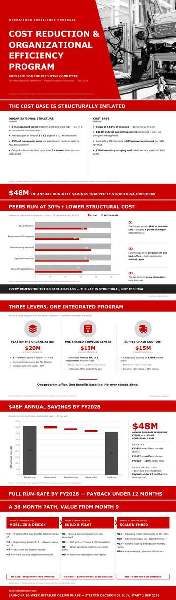

### Promotion

#### `gold-orange-type-journal` — Gold Orange Type Journal
- **Spec**: Palette-only (no design.md spec)
- **Look**: Gold-orange type-trends journal
- **Invoke**: `use gold-orange-type-journal`

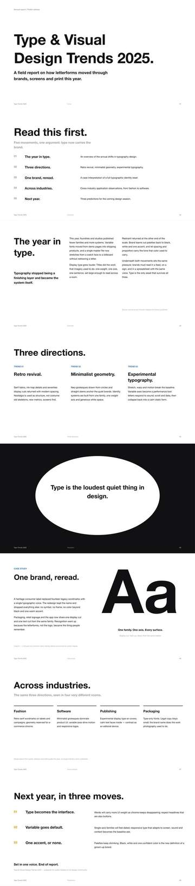

#### `fresh-brand` — Fresh Brand
- **Spec**: Palette-only (no design.md spec)
- **Look**: Fresh brand equity / impact report
- **Invoke**: `use fresh-brand`

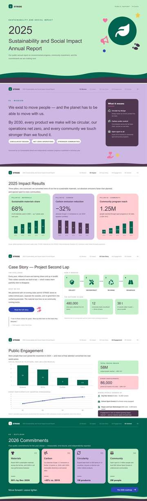

### Academic

#### `pink-purple-diagnosis` — Soft Cloud-Layer Diagnostic Narrative
- **Spec**: Palette-only (no design.md spec)
- **Look**: Pink-purple cloud-layer diagnostic narrative
- **Invoke**: `use pink-purple-diagnosis`

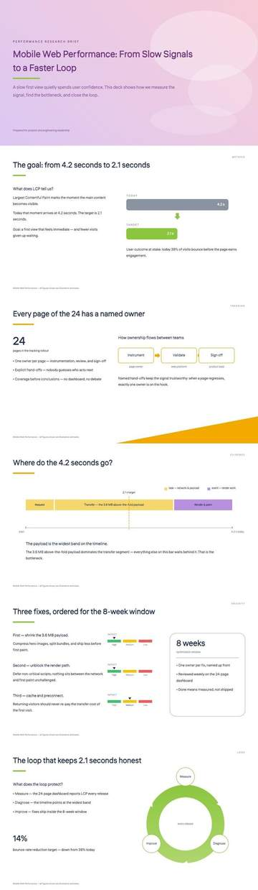

#### `dark-themed-data` — Dark Themed Data
- **Spec**: Palette-only (no design.md spec)
- **Look**: Dark-themed data dashboard for crypto / market research
- **Invoke**: `use dark-themed-data`

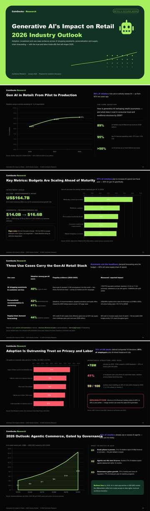

---

## Quick index

| Category | Theme IDs |
|---|---|
| Consulting / Strategy | `apricot-white-brief` · `indigo-due-diligence` · `marine-blue-research` · `moss-green-transformation` · `pine-green-strategy` · `red-black-growth` |
| Finance / Business | `black-gold-ledger` · `ebony-ledger` · `honey-orange-memo` · `lake-blue-memo` · `prospect-annual` · `rice-paper-annual` |
| Work Report | `blue-flame-brand` · `electric-violet-business` · `moon-white-imagery` · `sky-blue-wayfinding` · `warm-clay-works` · `warm-jade-annual-report` |
| Promotion / Brand | `aqua-charity-report` · `cream-collage` · `pine-soot-pictorial` · `silk-yellow-magazine` · `silver-gray-luxury-magazine` · `travel-green-handbook` |
| Academic | `blue-line-courseware` · `deep-blue-atlas` · `paper-white-courseware` · `pastel-derivation` · `teal-green-academic-defense` · `wine-red-data` |
| Extra (Palette-Only) | `dusk-violet-consulting` · `red-black-business` · `map-strategy` · `xuan-paper-annual` · `lead-gray-quarterly` · `ink-green-market-trends` · `orange-tech` · `mist-blue-travelogue` · `color-stripes-documentary` · `red-white-business` · `gold-orange-type-journal` · `fresh-brand` · `pink-purple-diagnosis` · `dark-themed-data` |

## Counts

- Primary catalog: **30**
- Extra catalog: **14**
- Total: **44**
